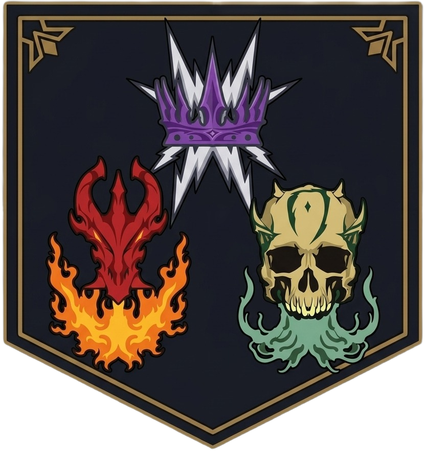
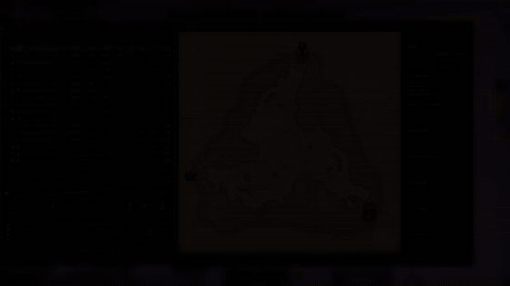
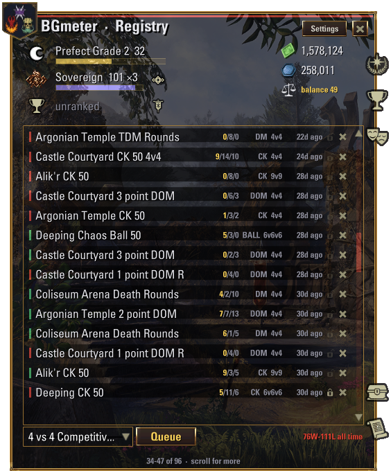

# BGmeter

_BGmeter is not created by, affiliated with, or sponsored by ZeniMax Media Inc. or its affiliates. The Elder Scrolls® and related logos are registered trademarks or trademarks of ZeniMax Media Inc. in the United States and/or other countries. All in-game imagery, icons and emblem designs shown or adapted in this repository (including the BGmeter logo, which is derived from in-game battleground team emblems) are the property of ZeniMax Media Inc., are used for non-commercial, informational purposes only, and no ownership over them is claimed._

  

**Battleground records for The Elder Scrolls Online.**
An addon that records Battleground events and shows them at the end of the match in a friendly way. It also keeps a registry of your games and other tools to help you keep track of your matches. The aim of the project is to emphasize the value of teamwork across the different Battleground modes rather than the individual performance of a player.

Thanks to unit220 and ruskiii for testing and suggestions. Thanks to Solinur, whose [LibCombat](https://github.com/Solinur/LibCombat) taught me how the game's combat events are meant to be consumed. The research this addon draws on is credited at the end.

A mention too for Solantris's [Battleboard](https://www.esoui.com/downloads/info4672-Battleboard.html), a great improvement over the game's own scoreboard. Go check it out.

  

Click the preview for the full-quality video.

## The Battle Report

Scoreboard with damage, healing, K/D/A, objectives and medals, sortable by any column. Below it, the match as it happened: score over time, combat momentum and the objective lanes of the mode you played (flags, relics, ball carriers, kill pressure). On the right, your haul: AP, XP, Champion Points, veterancy, medals, your title for the match and your competitive standing. Every mode is covered, multi-round formats included, and each match has a map of where it was fought.

## The Registry

Every recorded battle in one list, with your rank progress and currencies on top. The icons on its edge open your personal bests, your record per arena and the faces you keep meeting. You can queue from here too.

  

## Install and use

Download from [ESOUI](https://www.esoui.com/) and extract into `Documents/Elder Scrolls Online/live/AddOns/`. No dependencies.

| | |
|---|---|
| `/bgmeter` | Open or close the Registry |
| Launcher | Draggable shield on screen, click to open (can be turned off) |
| Keybind | *Toggle BGmeter* under Controls → Keybindings |

Settings live behind the **Settings** button of either window.

## Performance

BGmeter stays out of the way while you fight: combat events are filtered by the game engine, not in Lua, the per-sample path allocates no memory, and nothing is written to chat. Bugs and ideas: a comment on ESOUI or an issue here.

## Where the ideas come from

BGmeter was written with the help of a coding agent. The ideas below reached the code through it and through me, and none of them is ours, so their authors are named here. Links go to the authors' own copies where one exists; the rest point to the publisher.

- The radar reads shapes rather than areas because of Cleveland & McGill, [*Graphical Perception*](https://doi.org/10.1080/01621459.1984.10478080) (JASA, 1984), and keeps to the limits set out by Draper, Livnat & Riesenfeld in [*A Survey of Radial Methods for Information Visualization*](https://doi.org/10.1109/TVCG.2009.23) (IEEE TVCG, 2009).
- The team cohesion and distance cards on the map use the team centroid and spread of Frencken, Lemmink, Delleman & Visscher, [*Oscillations of centroid position and surface area of soccer teams in small-sided games*](https://doi.org/10.1080/17461391.2010.499967) (European Journal of Sport Science, 2011), Bourbousson, Sève & McGarry, [*Space-time coordination dynamics in basketball, Part 2*](https://mip.univ-nantes.fr/medias/fichier/2010bourboussonsevemcgarryjss2_1266958503934.pdf?ID_FICHE=420463&INLINE=FALSE) (Journal of Sports Sciences, 2010) and Drachen et al., [*Skill-based differences in spatio-temporal team behaviour in DotA 2*](https://arxiv.org/abs/1603.07738) (IEEE GEM, 2014).
- The reading of momentum and comebacks follows Elias, Garfield & Gutschera, [*Characteristics of Games*](https://mitpress.mit.edu/9780262017138/characteristics-of-games/) (MIT Press, 2012).
- The performance rules follow Holzmann, [*The Power of 10*](https://spinroot.com/gerard/pdf/P10.pdf) (IEEE Computer, 2006), Ierusalimschy, [*Lua Performance Tips*](https://www.lua.org/gems/sample.pdf) (Lua Programming Gems, 2008) and Nystrom, [*Game Programming Patterns*](https://gameprogrammingpatterns.com/).

## License

[MIT](LICENSE), covering the addon code only. Game artwork and derived designs remain the property of ZeniMax Media Inc.
